*This project has been created as part of the 42 curriculum by tcros.*

<!-- GUIDE DE RÉDACTION (à supprimer quand tout est écrit)

Qui écrit quoi :
  - Claude a fourni la structure, les figures (docs/diagrams, avec de courtes explications) et les faits tirés du code
    (valeurs, tableaux, formules recopiées du code, noms de fichiers).
  - Toutes les explications (le « comment ça marche » et le « pourquoi ») sont à toi : ce sont les TODO(Theo).

Deux niveaux de lecture :
  - Description, Instructions, Features : pour quelqu'un qui n'a jamais fait de 3D.
    Aucun nom de fonction, aucun mot technique qui ne soit pas dans « Words to know ».
  - Technical overview : pour un dev ou un correcteur. Noms du code autorisés, entre `backticks`.

Pour que ce soit digeste :
  - Une idée par paragraphe, 3 à 5 lignes maximum.
  - Phrases courtes (environ 20 mots). Si tu reprends ton souffle en la lisant à voix haute, coupe-la.
  - Voix active : « le parser lit chaque ligne » plutôt que « chaque ligne est lue ».
  - Le pourquoi d'abord, le comment ensuite.
  - Sous chaque schéma : une phrase qui dit quoi regarder, puis le détail.
  - Un exemple concret vaut mieux qu'une définition (teapot.obj, le « L » de concave_test.obj…).
  - Écris en anglais simple : tu peux rédiger en français d'abord, puis traduire toi-même.
  - La Description doit se lire en 5 minutes : environ 400 à 600 mots en tout.
-->

<div align="center">


****
**Home-made introduction to graphical modelling, made on the Vulkan API with Rust**

[](https://rust-lang.org/)
[](https://vulkan.org/)
[](https://www.42network.org/)

</div>

> [!TIP]
> **How to read this README**
>
> - **In 5 minutes, no 3D knowledge needed:** [Description](#description), then [Instructions](#instructions) and [Features](#features).
> - **In depth:** [Technical overview](#technical-overview): how the code works, the math, the choices I made and the bugs I met.

## Table of contents

- [Description](#description): Scop in 5 minutes
- [Instructions](#instructions): quick start, controls, prerequisites
- [Features](#features): mandatory part, bonus, extras
- [Technical overview](#technical-overview)
  - [Built on the vulkanalia tutorial](#built-on-the-vulkanalia-tutorial)
  - [How it works](#how-it-works):  
    [1. Data pipeline](#1-the-data-pipeline)  
    [2. OBJ parser](#2-the-obj-parser)  
    [3. Triangulation](#3-triangulation-fan-then-ear-clipping)  
    [4. Matrices](#4-from-the-file-to-the-screen-the-matrices)  
    [5. Vulkan objects](#5-vulkan-objects-and-their-lifecycle)  
    [6. One frame](#6-rendering-one-frame)  
    [7. Shaders](#7-shaders-and-push-constants)  
    [8. Textures](#8-textures-and-uv-coordinates)  
    [9. Keyboard](#9-keyboard-input-movement-and-rotation)  
  - [The math behind Scop](#the-math-behind-scop)
  - [Technical choices](#technical-choices)
  - [Bugs & lessons learned](#bugs--lessons-learned)
  - [Project structure](#project-structure)
  - [Known limitations / future work](#known-limitations--future-work)
- [Resources](#resources): references, AI usage

****

## Description

> [!NOTE]
> ⏱️ **Scop in 5 minutes.** No 3D knowledge needed: every technical word is in [Words to know](#words-to-know).

### What is Scop

Scop is the first graphics project after the core curriculum at École 42.

In this project, we build an application from scratch that displays a 3D object in a window, rotates it, and moves it along all axes.  
I chose Vulkan over OpenGL for this project because this API allows for a great deal of flexibility in configuration—and therefore optimization—which is essential in video game development.  
This choice came at the cost of numerous lines of configuration code (~1,200 lines with Vulkan versus ~30 for OpenGL for the same result) but gave me a much more comprehensive understanding of CPU/GPU interaction in modeling calculations.

The Vulkan setup was completed by following Kyles Meyes’ tutorial on vulkanalia (see the section [Built on the vulkanalia tutorial](#built-on-the-vulkanalia-tutorial)).

### What you see

| Grey view | Textured view |
| :---: | :---: |
| 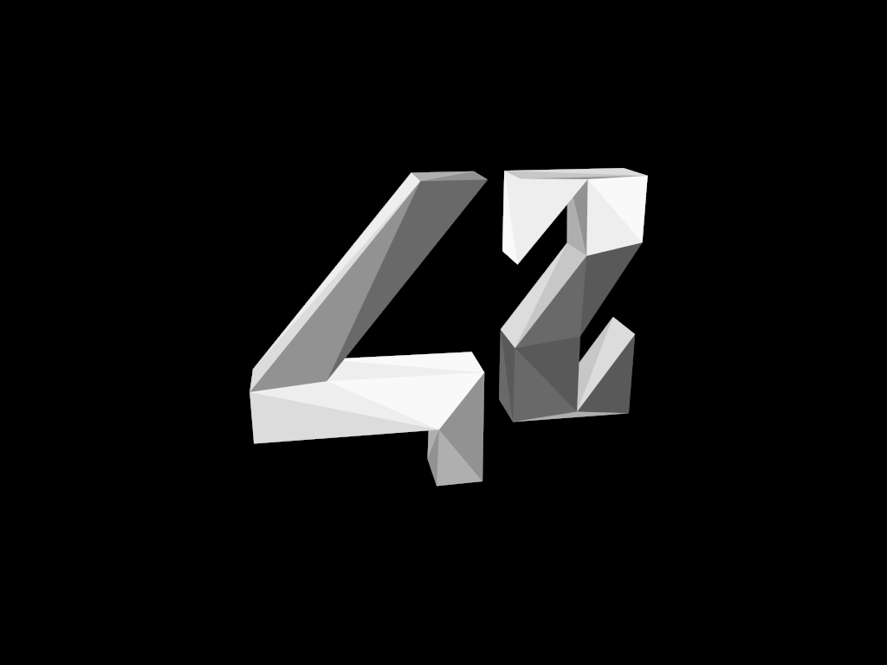 | 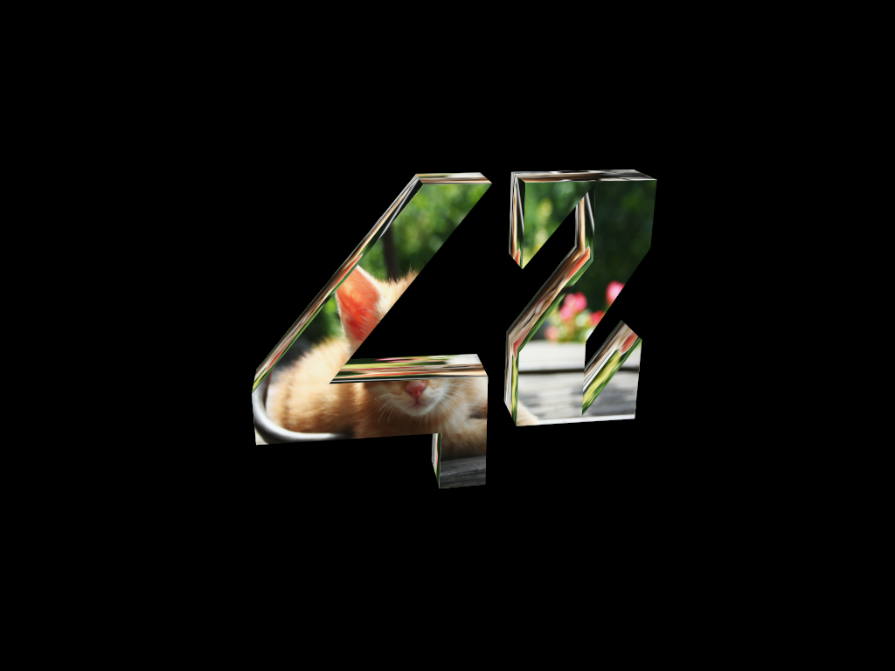 |
| **Transition grey ↔ texture** | **Utah teapot** |
| 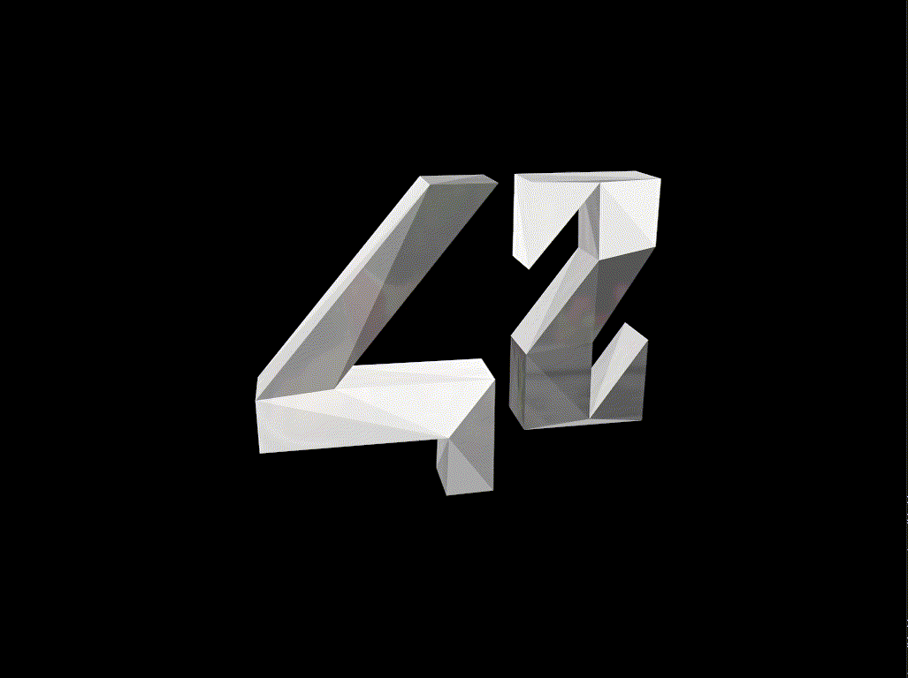 | 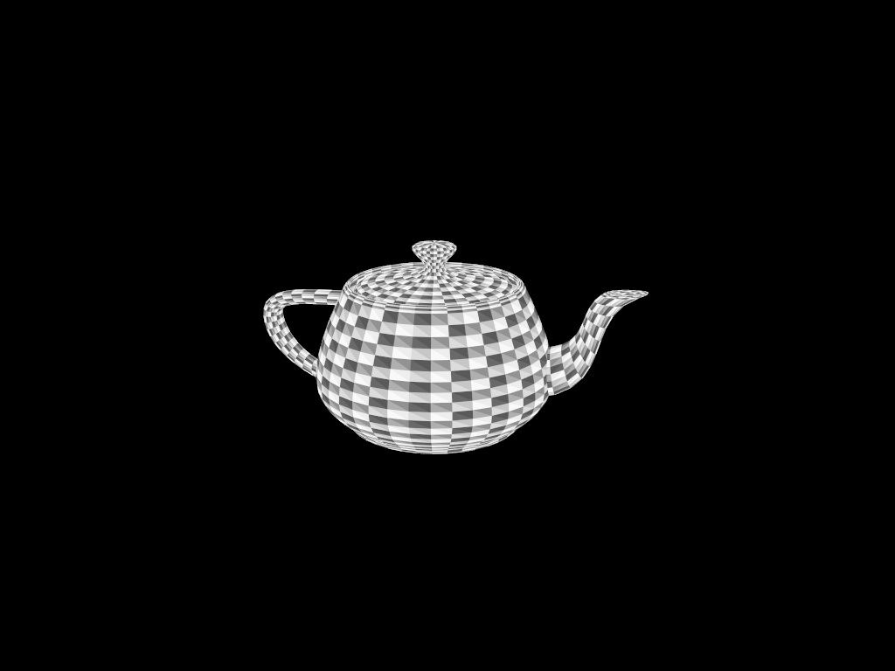 |

### How it works, in 6 steps

<p align="center">
  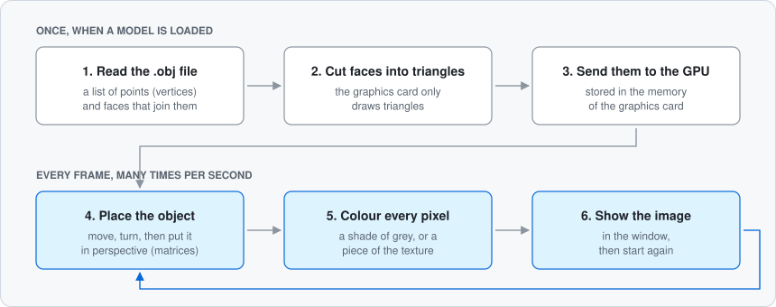
</p>

- **Step 1:**
We need to read the .obj file, as specified in the subject. To do this, we examine each line and create a list of corner points (called **Vertices**) and **Faces**.

- **Step 2:**
Next, we need to divide these **Faces** into **Triangles** so that the **GPU** can render our model. Triangulation is necessary because the **GPU** cannot render anything other than **Triangles**. We then prepare to apply the **Texture**. If the .obj file contains **UV coordinates**, each **Vertex** already knows which location on the **Texture** it corresponds to. Otherwise, we calculate them by projection, based on the **Normal** of each **Triangle**.

- **Step 3:**
All of the object’s **Triangles** are then sent to the **GPU** so that it keeps them in memory and does not need them again.

*Here, we separate the one-time steps from those performed on every **Frame**. This is necessary to render a moving, textured object in real time. This prevents the file from being re-read unnecessarily, avoiding redundant calculations on the CPU.*

- **Step 4:**
We then assign a transformation **Matrix** to our model, which defines its rotation and position in space. It also undergoes a **Perspective** transformation that makes it appear smaller depending on its distance.

- **Step 5:**
The **GPU** then colors each pixel of the object using the **Shader**. For each pixel, it reads the **Texture** at the location specified by the **UV coordinates**, or selects a shade of grey specific to each **Triangle**, depending on the selected view. The transition from one view to another is smooth, achieved by gradually blending the two colors.

- **Step 6:**
The newly created image is then placed in a **Swapchain** and rendered directly to the window. The **Swapchain** allows for a seamless transition from one **Frame** to the next without losing the image being rendered, enabling the **GPU** to render the next one; thus, the displayed image is always complete.

*Et voilà !*  
Our exquisite model is rendered in real time before your beautiful eyes !

### Words to know

<!-- TODO(Theo): Pour chaque mot : une ou deux phrases, sans jargon, avec si possible une analogie de la vie courante. -->
<!--      Test : un ami qui n'a jamais fait de 3D comprendrait-il ta phrase sans lire les autres ? -->

#### The object

**Vertex :**
A Vertex is defined as a corner of the model you want to render. In my Scop, it contains 2 things : position and texture coordinates (UV coordinates).

**Face :**
A Face is a polygon made of vertices and it is retrieved from the .obj. Unlike a triangle, it can have more than 3 vertices. So, before drawing, Scop cuts each face into triangles.

**Triangle :**
Triangles are the building blocks of 3D modelling. Nowadays GPUs are optimized for rendering triangles because of their simplicity. Besides, a triangle is necessarily flat and convex whereas a quadrilateral may not be.

**Mesh :**
A polygon mesh is a collection of vertices and faces that defines the shape of an object's surface. Accordingly, a mesh represents only the surface hence the "hollowness" of the meshes.

**Normal :**
In geometry, the normal is the perpendicular vector of a surface. In scop, normals are used for knowing the orientation of a face and so, knowing how to flatten the face to avoid graphical artefact, but also to apply a texture (only in box mapping mode).

#### Painting it

**Texture :**
A texture is simply a grid of numbers stored in the GPU's memory. It tells what colors are in the grid by storing Red, Green, Blue and Alpha channels (RGBA) per pixel. The value of each channel can go from 0 to 255. However, the alpha channel isn't provided by the .ppm file so we give it 255 (opaque). Each Vertex stores the position on the image, called UV coordinates.

**UV coordinates :**
To tell how a Texture must be applied on a Triangle, the GPU needs coordinates, which are called UV coordinates. They are a position on the image, hence the U and V instead of X and Y, which are used for world coordinates. They range from (0, 0), the upper left of the texture, to (1, 1), the lower right. If the coordinates go beyond 1, the texture just repeats itself.

**Shader :**
A shader is a program executed by the GPU. It needs to be compiled before it can be used. We compile 2 distinct shaders : shader.vert, which computes the poosition of a vertex, shader.frag, which computes how a pixel will be rendered. Both are compiled into .spv files which is loaded by Vulkan. The execution of shaders varies from zero to millions of times per frame : shader.vert is executed once per vertex and shader.frag is executed once per pixel.

#### Placing it

**Matrix**
<!-- Questions pour t'aider :
     - Qu'est-ce qu'une matrice 4×4 « fait » à un point ?
     - Pourquoi est-ce pratique de multiplier plusieurs matrices entre elles ?
     Fichiers à relire : src/math.rs (Matrix4)
-->

**Perspective**
<!-- Questions pour t'aider :
     - Pourquoi un objet lointain paraît-il plus petit ?
     - Que représentent le champ de vision (45°), near (0.1) et far (10) ?
     Fichiers à relire : src/math.rs (perspective), src/app/render.rs (update_uniform_buffer)
-->

#### Showing it

**GPU**
<!-- Questions pour t'aider :
     - En quoi le GPU est-il différent du CPU ? Pourquoi est-il bon pour dessiner ?
     - Comment Scop choisit-il le GPU à utiliser ?
     Fichiers à relire : src/vulkan/device.rs (pick_physical_device)
-->

**Vulkan**
<!-- Questions pour t'aider :
     - Vulkan est-il une bibliothèque de dessin, ou un moyen de parler au GPU ?
     - Pourquoi dit-on que Vulkan est « bas niveau » par rapport à OpenGL ?
     Fichiers à relire : src/vulkan/instance.rs, src/app.rs (App::create)
-->

**Frame**
<!-- Questions pour t'aider :
     - Combien de frames par seconde environ, et qu'est-ce qui les déclenche dans Scop ?
     - Que veut dire « frames in flight » (MAX_FRAMES_IN_FLIGHT = 2) ?
     Fichiers à relire : src/main.rs (RedrawRequested), src/vulkan/sync.rs
-->

**Swapchain**
<!-- Questions pour t'aider :
     - Pourquoi a-t-on plusieurs images au lieu d'une seule ?
     - Quand faut-il la recréer ?
     Fichiers à relire : src/vulkan/swapchain.rs, src/app.rs (recreate_swapchain)
-->

### Why this README

<!-- TODO(Theo): 2 ou 3 phrases, à la première personne.
     Questions pour t'aider :
     - Le projet a duré plusieurs mois : qu'est-ce que ce README t'aide à faire (t'approprier le code, réviser pour la soutenance) ?
     - Pourquoi as-tu tenu à écrire toutes les explications toi-même ?
-->

---

## Instructions

### Quick start

```sh
make deps            # check (and install if possible) the dependencies
make MODE=release    # build the optimised binary ./scop
./scop               # run it from the repository root
```

Scop opens `resources/model/42.obj`. `Enter` opens another model, `M` switches to the texture, `Escape` quits.

### Controls

Keys are read by their **physical position**, named after a QWERTY layout. On an AZERTY keyboard, `W` is the `Z` key, `A` is `Q`, `Q` is `A`.

<!-- TODO(Theo): Vérifie les équivalents AZERTY sur ton clavier (W/A/Q, et aussi = / - / 1 2 3 / 0) et corrige la phrase au-dessus si besoin. -->

**Hold a key** (several at once is fine):

| Key | Action |
| --- | --- |
| `W` / `S` | Move the model along the camera's forward axis (`W`: −forward, `S`: +forward) |
| `A` / `D` | Move the model along the camera's right axis (`A`: +right, `D`: −right) |
| `E` / `Q` | Move the model along the camera's up axis (`E`: +up, `Q`: −up) |
| `Left Shift` | Movement speed ×2 |
| `U` / `O` | Rotate the model around its own X axis |
| `I` / `K` | Rotate the model around its own Y axis |
| `L` / `J` | Rotate the model around its own Z axis |

<!-- TODO(Theo): Remplace « +forward / −right… » par ce que l'utilisateur voit à l'écran (plus près, plus loin, à gauche, à droite…) après avoir testé chaque touche. -->

**Press a key** (one action per press):

| Key | Action |
| --- | --- |
| `M` | Grey view ↔ textured view. Scop starts in grey view. |
| `←` / `→` | Previous / next texture from `resources/texture/` (textured view only) |
| `N` | Planar projection ↔ box mapping for the generated texture coordinates. Scop starts in box mode |
| `1` / `2` / `3` | Change the projection axes of the generated texture coordinates (planar mode only) |
| `Enter` | Open another `.obj` model |
| `=` / `-` | Automatic rotation speed: `=` −15°/s, `-` +15°/s (limited to ±720°/s) |
| `0` | Stop the automatic rotation |
| `Escape` | Quit (closing the window also quits) |

### Prerequisites

| What | Required? | Notes |
| --- | --- | --- |
| Rust toolchain (`cargo`) | Yes | Rust 1.85 or newer (`edition = "2024"`). `make deps` installs it with rustup if missing. |
| Vulkan loader (`libvulkan.so.1`) and a Vulkan GPU driver | Yes | Checked by `make deps`. |
| GPU features `samplerAnisotropy` and `geometryShader` | Yes | Requested when the logical device is created. |
| Validation layers (`VK_LAYER_KHRONOS_validation`) | Only for `MODE=dev` | Without them, a debug build stops with `Validation layer requested but not supported.` |
| `glslc` (shader compiler) | No | Without it, the committed `shaders/*.spv` are used. |

<!-- TODO(Theo): Explique ce dont le sélecteur de fichiers (crate rfd) a besoin sous Linux / sur les postes de 42, s'il y a quelque chose.
     Questions pour t'aider :
     - As-tu testé `Enter` sur un poste de 42 ? Que faut-il d'installé pour que la fenêtre de sélection s'ouvre ?
     Fichiers à relire : src/key.rs (file_manager), Cargo.toml
-->

### Build options

```sh
make                       # debug build, validation layers on: target/debug/scop
make run                   # build and run in one step (debug by default)
RUST_LOG=info make run     # also print the log messages (validation layers, chosen GPU…)
```

The program takes no command-line argument: it always starts on `resources/model/42.obj` (`DEFAULT_MODEL` in `src/app.rs`). Paths to `resources/` are relative: run it from the repository root.

<details>
<summary><b>All Makefile rules</b></summary>

All rules accept `MODE=dev` (default) or `MODE=release`.

| Rule | What it does |
| --- | --- |
| `make` / `make all` | Compiles the shaders and the project. With `MODE=release`, also copies the binary to `./scop`. |
| `make scop` | Compiles and copies the binary to `./scop`. |
| `make build` | Compiles the shaders and the project, without copying the binary. |
| `make compile-shaders` | Runs `shaders/compile.sh` only. |
| `make run` | Compiles the shaders, then `cargo run`. |
| `make test` | `cargo test`. |
| `make clippy` | `cargo clippy` with warnings treated as errors. |
| `make fix` | `cargo clippy --fix` after a `[y/N]` confirmation. |
| `make deps` | Checks `cargo` (installs rustup if missing), `glslc` (warning only), the Vulkan loader (error if missing) and the validation layers (warning only). |
| `make help` | Prints the list of rules. |
| `make clean` | `cargo clean`. |
| `make fclean` | `clean` + removes `./scop`. |
| `make re` | `fclean` then `all`. |

</details>

---

## Features

<!-- TODO(Theo): Après chaque nom de fonctionnalité, écris UNE phrase qui dit ce que l'utilisateur voit ou peut faire.
     Pas de nom de fonction ici : les détails sont dans Technical overview.
     Le commentaire de chaque ligne te rappelle les faits et le fichier à relire.
-->

### Mandatory part

- **Home-made `.obj` loader**: <!-- TODO(Theo): une phrase. Faits : positions, UV, normales, faces, indices négatifs, erreurs avec numéro de ligne. src/obj.rs -->
- **Perspective 3D view**: <!-- TODO(Theo): une phrase. Faits : perspective + depth buffer. src/math.rs, src/vulkan/attachment.rs -->
- **Rotation around the object's centre**: <!-- TODO(Theo): une phrase. Faits : centre de la bounding box, taille ramenée à TARGET_SIZE = 1.5. src/model.rs, src/obj.rs (compute_centroid) -->
- **Translation on the 3 axes, both ways**: <!-- TODO(Theo): une phrase. src/key.rs (move_model), src/app/render.rs -->
- **Faces in shades of grey**: <!-- TODO(Theo): une phrase. Faits : 8 gris, un par triangle, via gl_PrimitiveID. shaders/shader.frag -->
- **Texture toggle with a smooth transition (`M`)**: <!-- TODO(Theo): une phrase. Faits : mix, environ 0,2 s. shaders/shader.frag, src/app/render.rs (mesh_view_value) -->
- **Home-made `.ppm` texture loader**: <!-- TODO(Theo): une phrase. Faits : P6 seulement. src/ppm.rs -->
- **Generated texture coordinates**: <!-- TODO(Theo): une phrase. Faits : projection plane quand le .obj n'a pas de vt. src/model.rs (build_vertex, load_model) -->
- **Home-made math library**: <!-- TODO(Theo): une phrase. Faits : vecteurs, matrices 4×4, perspective, look-at, rotation autour d'un axe. src/math.rs -->

### Bonus

- **Ear clipping triangulation**: <!-- TODO(Theo): une phrase. Faits : faces concaves et non planes, normale de Newell, projection 2D, repli en éventail. src/obj.rs (triangulate_face, project_face_2d) -->
- **Box mapping**: <!-- TODO(Theo): une phrase. Faits : axe de projection choisi par triangle selon sa normale, clé de déduplication (FaceVertex, axes), bascule avec la touche KEY. src/model.rs (load_model), src/obj.rs (get_normal_axis_max) -->

### Extras

<details>
<summary><b>12 features added on top of the subject</b></summary>

- **File picker (`Enter`)**: <!-- TODO(Theo): une phrase. Faits : crate rfd, charge un autre .obj sans redémarrer. src/key.rs (file_manager), src/app/render.rs (reload_model) -->
- **Texture switching (`←` / `→`)**: <!-- TODO(Theo): une phrase. Faits : tous les .ppm de resources/texture/. src/key.rs (change_texture_index), src/vulkan/texture.rs (init_texture_path) -->
- **Choice of the UV projection axes (`1`, `2`, `3`)**: <!-- TODO(Theo): une phrase. Faits : mode projection plane uniquement. src/model.rs (tex_axe), src/main.rs (Signal::TextureAxe) -->
- **Texture repetition**: <!-- TODO(Theo): une phrase. Faits : sampler REPEAT + TEXTURE_ZOOM (constante 1.0, pas de touche). src/vulkan/texture.rs, src/model.rs -->
- **Adjustable rotation speed (`=` / `-` / `0`)**: <!-- TODO(Theo): une phrase. Faits : pas de 15°/s, limite ±720°/s. src/key.rs, src/main.rs (UpdateAngleSpeed) -->
- **Manual rotation (`I` `K` `U` `O` `J` `L`)**: <!-- TODO(Theo): une phrase. Faits : 50°/s, autour des axes de l'objet. src/key.rs (rotate_model), src/app/render.rs (orientation) -->
- **Sprint (`Left Shift`)**: <!-- TODO(Theo): une phrase. Faits : vitesse ×2. src/main.rs (BASE_SPEED, SPRINT_SPEED) -->
- **Camera-relative movement**: <!-- TODO(Theo): une phrase. Faits : axes forward / right / up de la caméra. src/math.rs (camera_basis), src/app/render.rs -->
- **MSAA**: <!-- TODO(Theo): une phrase. Faits : le plus grand nombre d'échantillons supporté par le GPU. src/vulkan/device.rs (get_max_msaa_samples), src/vulkan/attachment.rs -->
- **Mipmaps**: <!-- TODO(Theo): une phrase. Faits : générées sur le GPU. src/vulkan/texture.rs (generate_mipmaps) -->
- **Window resize and minimisation**: <!-- TODO(Theo): une phrase. Faits : recréation de la swapchain. src/main.rs (Resized), src/app.rs (recreate_swapchain) -->
- **Debug messages in `MODE=dev`**: <!-- TODO(Theo): une phrase. Faits : validation layers, RUST_LOG. src/vulkan/instance.rs -->

</details>

---

## Technical overview

> [!NOTE]
> This part follows the code, file by file. It uses the words of [Words to know](#words-to-know) and the names from the code (`written like this`).

### Built on the vulkanalia tutorial

The Vulkan part of Scop comes from the [Vulkan Tutorial (Rust) by Kyle Mayes](https://kylemayes.github.io/vulkanalia/), chapters 1 to 37. The table below shows where each part of the project comes from.

| Part of the project | Origin | Files |
| --- | --- | --- |
| Window and event loop (`winit`) | Tutorial | `src/main.rs` |
| Vulkan setup: instance, validation, device, swapchain, render pass, pipeline, framebuffers, command buffers, synchronisation | Tutorial, then fixed (see [bugs 3 to 9](#memory)) | `src/app.rs`, `src/vulkan/` |
| Vertex and index buffers, uniform buffers, descriptor sets, depth buffer, textures, swapchain recreation | Tutorial | `src/vulkan/` |
| Mipmaps, MSAA, push constants, secondary command buffers | Tutorial (optional chapters) | `src/vulkan/`, `src/app/render.rs` |
| Math library | Rewritten: the tutorial uses the `cgmath` crate, forbidden by the subject | `src/math.rs` |
| OBJ parser | Rewritten: the tutorial uses the `tobj` crate | `src/obj.rs` |
| Texture loader | Rewritten: the tutorial uses the `png` crate | `src/ppm.rs` |
| Shaders | Tutorial, extended (grey faces, transition) | `shaders/` |
| Ear clipping triangulation | Mine | `src/obj.rs` |
| Centring, scaling and axis reordering of the model | Mine | `src/model.rs` |
| Generated texture coordinates: planar projection, then box mapping | Mine | `src/model.rs`, `src/obj.rs` |
| Keyboard movement and rotation | Mine | `src/key.rs`, `src/main.rs`, `src/app/render.rs` |
| Grey faces and grey ↔ texture transition | Mine | `shaders/shader.frag`, `src/app/render.rs` |
| File picker, texture switching | Mine | `src/key.rs` |
| Makefile, `shaders/compile.sh` | Mine (with AI help, see [AI usage](#ai-usage)) | `Makefile`, `shaders/compile.sh` |

<!-- TODO(Theo): Vérifie la colonne « Origin » ligne par ligne (elle vient de scop_requirements.txt), puis écris 2 ou 3 phrases :
     Questions pour t'aider :
     - Qu'as-tu appris en suivant le tuto, et qu'as-tu appris en le quittant ?
     - Qu'as-tu dû corriger dans le code du tuto (bugs 3 à 9) ?
     - Quelle partie « à moi » t'a demandé le plus de travail ?
-->

### How it works

#### 1. The data pipeline

<!-- TODO(Theo): En une phrase : comment un fichier texte devient-il des triangles stockés sur la carte graphique ? -->

<p align="center">
  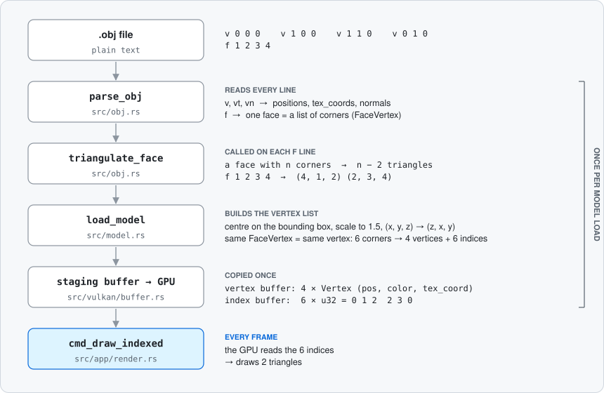
</p>

In the code:

- `TARGET_SIZE = 1.5`; a `FaceVertex` is the triplet of indices (position, `vt`, `vn`) of one corner.
- The staging buffer lives in CPU-visible memory; its content is copied once to device-local memory.
- The vertex and index buffers are rebuilt when another model is loaded (`Enter`), when the UV axes change (`1`/`2`/`3`), or when the texture mapping mode changes (`N`).

<!-- TODO(Theo): Explique le pipeline étape par étape.
     Questions pour t'aider :
     - Pourquoi ne pas envoyer directement les faces au GPU ? À quoi servent les indices ?
     - Pourquoi centrer et redimensionner le modèle ? Que se passerait-il avec teapot.obj sinon ?
     - Pourquoi réordonner les axes (x, y, z) en (z, x, y) ? (indice : UP = (0, 0, 1) dans render.rs)
     - Pourquoi passer par un staging buffer au lieu d'écrire directement dans la mémoire du GPU ?
     Fichiers à relire : src/obj.rs, src/model.rs, src/vulkan/buffer.rs
-->

#### 2. The OBJ parser

<!-- TODO(Theo): En une phrase : que lit le parser, et que rend-il ? -->

| Line | Read as | Notes |
| --- | --- | --- |
| `v x y z [w]` | position | `w` is optional and ignored; more values is an error |
| `vt u v [w]` | texture coordinate | `w` optional and ignored |
| `vn x y z` | normal | stored, not used for rendering |
| `f …` | face (3 vertices or more) | triangulated right away |
| anything else (`#`, `o`, `g`, `s`, `usemtl`, empty…) | ignored | |

| Face syntax | Example |
| --- | --- |
| `v` | `f 1 2 3` |
| `v/vt` | `f 1/1 2/2 3/3` |
| `v//vn` | `f 1//1 2//1 3//1` |
| `v/vt/vn` | `f 1/1/1 2/2/1 3/3/1` |

- All corners of one face must use the same syntax (same number of `/`), otherwise `MalformedLine`.
- Indices are read as `i32` (`RawFaceVertex`), then converted to `usize` (`FaceVertex`) by `resolve_index`. Negative indices are accepted; `0` and out-of-range indices give `InvalidIndex`.
- Errors (`ObjError`): `MalformedLine` (line number + content), `InvalidIndex` (line number), `IoError`.
- Test file: `resources/model/42_bugged.obj` has a malformed `v` line (line 6).

<!-- TODO(Theo): Explique comment le parser fonctionne et comment il échoue.
     Questions pour t'aider :
     - Pourquoi lire en i32 puis convertir en usize ?
     - Comment un indice négatif est-il résolu ? Pourquoi dépend-il de l'endroit où se trouve la ligne dans le fichier ?
     - Que voit l'utilisateur si le fichier est faux, au démarrage et quand il charge un modèle avec Entrée ?
     Fichiers à relire : src/obj.rs (resolve_index, parse_face_line), resources/model/42_bugged.obj
-->

#### 3. Triangulation: fan, then ear clipping

<!-- TODO(Theo): En une phrase : comment découper une face à plusieurs coins en triangles sans déborder à l'extérieur ? -->

- **Fan** (before commit `cb4ef8b`): triangles `(v0, vi, vi+1)` for `i` from 1 to `n − 2`.
- **Ear clipping** (current version): `triangulate_face` in `src/obj.rs`.

<p align="center">
  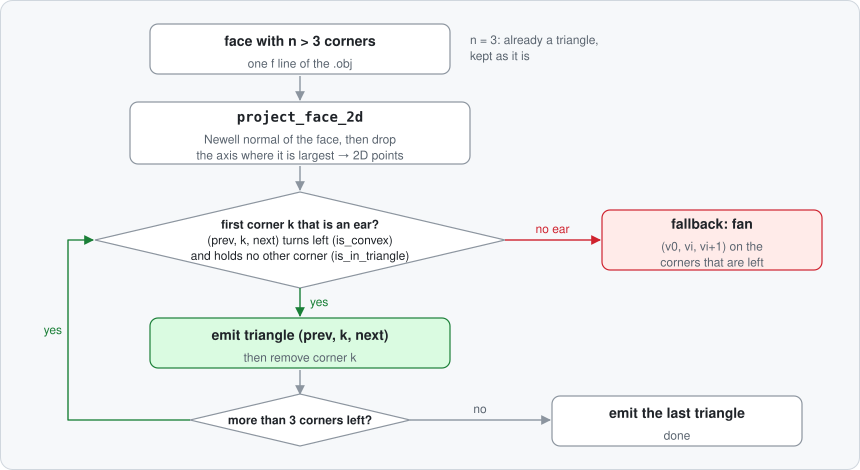
</p>

The formulas behind `project_face_2d`, `is_convex` and `is_in_triangle` are in [The math behind Scop](#geometry).

**Example:** the "L" face of `resources/model/concave_test.obj` (`f 1 2 3 4 5 6`, plane `z = 0`). Both triangulations below were computed by running the same steps as the code.

<p align="center">
  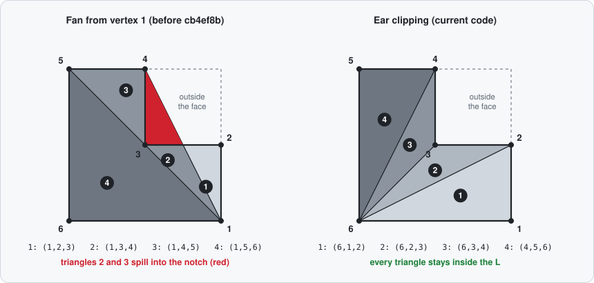
</p>

Screenshots from Scop:

| Fan (before `cb4ef8b`) | Ear clipping |
| :---: | :---: |
|  |  |

<!-- TODO(Theo): Explique l'ear clipping pas à pas, avec l'exemple du L.
     Questions pour t'aider :
     - Qu'est-ce qu'une « oreille » ? Pourquoi enlever une oreille ne casse-t-il jamais le reste du polygone ?
     - Pourquoi les triangles 2 et 3 de l'éventail débordent-ils dans l'encoche ? Qu'a de spécial le sommet 1 ?
     - Pourquoi projeter la face en 2D avant de chercher les oreilles ?
     - Quand le repli en éventail peut-il arriver ?
     Fichiers à relire : src/obj.rs (triangulate_face, project_face_2d, cross_2d, is_convex, is_in_triangle), resources/model/concave_test.obj
-->

#### 4. From the file to the screen: the matrices

<!-- TODO(Theo): En une phrase : quelles matrices amènent un point du fichier .obj à sa place sur l'écran ? -->

<p align="center">
  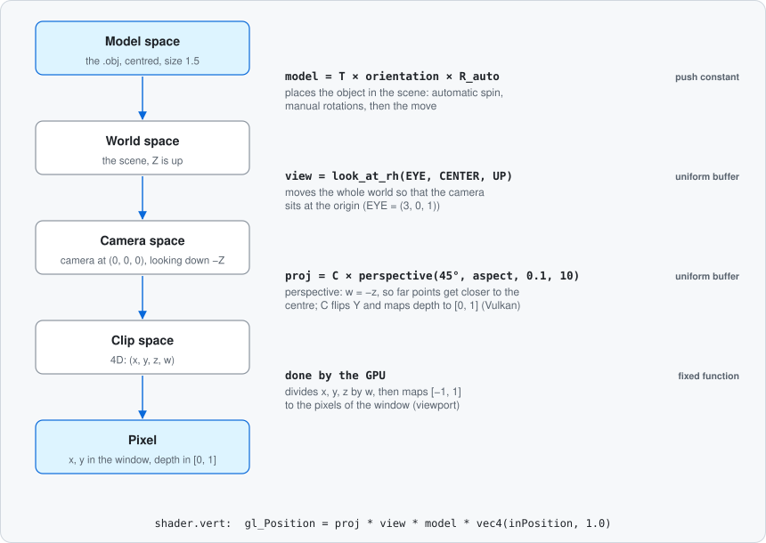
</p>

<p align="center">
  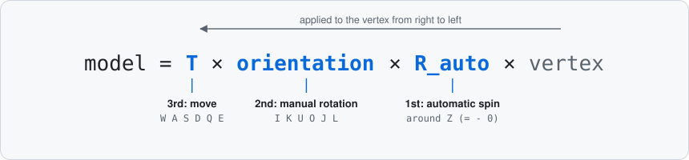
</p>

- All three matrices are sent every frame: `model` as a push constant, `view` and `proj` in the uniform buffer (`update_uniform_buffer`). `view` never changes; `proj` changes with the aspect ratio when the window is resized.
- `T = from_translation(curr_position)`, `orientation` = accumulated rotations, `R_auto = from_axis_angle(Z, curr_angle)` (`src/app/render.rs`).
- Vertex shader: `gl_Position = proj * view * model * vec4(inPosition, 1.0)`.
- Camera: `EYE = (3, 0, 1)`, `CENTER = (0, 0, 0)`, `UP = (0, 0, 1)`.
- Storage: **column-major**. `Matrix4 { x, y, z, w }` are the 4 columns (`Vector4`), `#[repr(C)]`; `Matrix4::new(c0r0, c0r1, …)` takes its arguments column by column.

The formulas of each matrix are in [The math behind Scop](#matrices).

<!-- TODO(Theo): Explique la chaîne de matrices.
     Questions pour t'aider :
     - Que représente chaque « space » du schéma ?
     - La figure donne l'ordre : pourquoi le spin automatique doit-il venir en premier ? Que se passerait-il si on inversait T et R ?
     - Que veut dire « column-major » ? Pourquoi faut-il la même convention que GLSL ?
     - Pourquoi un 4e composant w = 1 pour un point ?
     Fichiers à relire : src/math.rs, src/app/render.rs (update_uniform_buffer, update_secondary_command_buffer), shaders/shader.vert
-->

#### 5. Vulkan objects and their lifecycle

<!-- TODO(Theo): En une phrase : quels objets Vulkan vivent tout le programme, lesquels doivent être reconstruits, et quand ? -->

| Group | Objects | Rebuilt when | Code |
| --- | --- | --- | --- |
| **Whole program** | entry, instance, debug messenger (dev only), surface, physical device + MSAA sample count, logical device + graphics and present queues, descriptor set layout, global command pool, texture sampler, `image_available` semaphores and `in_flight` fences (×2) | never | `App::create`, `App::destroy` |
| **Swapchain** | swapchain + image views, render pass, pipeline + pipeline layout, MSAA colour image + depth image, framebuffers, uniform buffers, descriptor pool + sets, per-image command pools and command buffers, `render_finished` semaphores, `images_in_flight` | window resized or minimised, `OUT_OF_DATE_KHR`, `SUBOPTIMAL_KHR` | `recreate_swapchain`, `destroy_swapchain` |
| **User request** | texture image + view, descriptor pool + sets | `←` / `→` | `reload_texture` |
| | vertex buffer + index buffer | `Enter`, `1`, `2`, `3`, `N` | `reload_model` |
<!-- TODO(Theo): Explique le rôle et la durée de vie des principaux objets Vulkan.
     Questions pour t'aider :
     - Pour chaque groupe : pourquoi ces objets-là dépendent-ils (ou pas) de la swapchain ?
     - Pourquoi la render pass et le pipeline sont-ils recréés avec la swapchain ?
     - Dans quel ordre détruire, et pourquoi ? Que fait device_wait_idle avant de détruire ?
     - Pourquoi le descriptor pool est-il détruit aussi au changement de texture ?
     Fichiers à relire : src/app.rs (create, recreate_swapchain, destroy, destroy_swapchain), src/app/render.rs (reload_texture, reload_model), src/vulkan/*.rs
-->

#### 6. Rendering one frame

<!-- TODO(Theo): En une phrase : que se passe-t-il, dans l'ordre, entre « la fenêtre demande une nouvelle image » et « l'image est à l'écran » ? -->

<p align="center">
  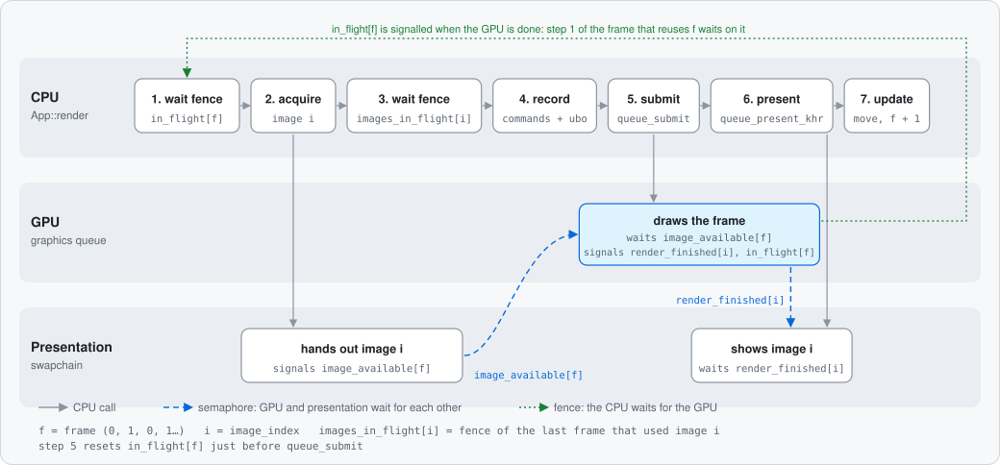
</p>

In the code:

- `MAX_FRAMES_IN_FLIGHT = 2`: `frame` goes 0, 1, 0, 1…; `image_index` is given by `acquire_next_image_khr`.
- `acquire_next_image_khr` returns `OUT_OF_DATE_KHR` → `recreate_swapchain`, the frame is skipped.
- `queue_present_khr` returns `SUBOPTIMAL_KHR` or `OUT_OF_DATE_KHR`, or the window was resized → `recreate_swapchain`.
- Before `wait_for_fences`: model or texture reload if requested (after `device_wait_idle`).
- `update_command_buffer` resets the image's command pool and records one primary and one secondary command buffer. The secondary one binds the pipeline, the vertex and index buffers and the descriptor set, pushes the push constants and calls `cmd_draw_indexed`.
- Present mode: `MAILBOX` if available, otherwise `FIFO`.
- A redraw is requested on every `AboutToWait` event; nothing is drawn while the window is minimised.

<!-- TODO(Theo): Explique la synchronisation d'une frame.
     Questions pour t'aider :
     - Quelle différence entre une fence et un sémaphore ? (la légende de la figure donne un indice)
     - Pourquoi image_available est-il indexé par frame, mais render_finished par image ?
     - À quoi sert images_in_flight ? Quel problème évite-t-il quand il y a plus d'images que de frames en vol ?
     - Pourquoi reset_fences juste avant queue_submit, et pas avant acquire_next_image_khr ?
     - Pourquoi le mouvement est-il mis à jour à la fin de render ? Quand se voit-il à l'écran ?
     - Primaire et secondaire : qui contient quoi ?
     Fichiers à relire : src/app/render.rs (render, update_command_buffer, update_secondary_command_buffer), src/vulkan/sync.rs, src/vulkan/command.rs
-->

#### 7. Shaders and push constants

<!-- TODO(Theo): En une phrase : que calculent les deux shaders, et comment le CPU leur envoie-t-il de petites valeurs à chaque frame ? -->

**Push constants** (72 bytes, two ranges: vertex `[0, 64)`, fragment `[64, 72)`):

| Offset | Size | Type | Name | Stage | Value |
| --- | --- | --- | --- | --- | --- |
| 0 | 64 | `mat4` | `model` | vertex | `T × orientation × R_auto` |
| 64 | 4 | `float` | `opacity` | fragment | `model_index + 1`, so `1.0` (one model) |
| 68 | 4 | `float` | `mesh_view` | fragment | `mesh_view_value`, from `0.0` (texture) to `1.0` (grey) |

**Descriptor set** (one per swapchain image):

| Binding | Type | Stage | Content |
| --- | --- | --- | --- |
| 0 | uniform buffer | vertex | `UniformBufferObject { view: mat4, proj: mat4 }` (128 bytes) |
| 1 | combined image sampler | fragment | current texture |

**Vertex layout** (`Vertex`, 32 bytes):

| Location | Field | Format | Offset |
| --- | --- | --- | --- |
| 0 | `pos` | `vec3` | 0 |
| 1 | `color` | `vec3` | 12 |
| 2 | `tex_coord` | `vec2` | 24 |

**Fragment shader** (`shaders/shader.frag`):

```glsl
float id = float(gl_PrimitiveID);
float shade = clamp((mod(id, 8.0) / 7.0), 0.1, 0.95);
outColor = vec4(mix(texture(texSampler, fragTexCoord).rgb, vec3(shade), pcs.mesh_view), pcs.opacity);
```

- `mesh_view_value` changes by `MESH_VIEW_SPEED × dt` (`MESH_VIEW_SPEED = 5.0`, so 0.2 s from 0 to 1) and is clamped to `[0, 1]`.
- Alpha blending is on (`SRC_ALPHA`, `ONE_MINUS_SRC_ALPHA`).
- The `.spv` files are embedded in the binary at compile time (`include_bytes!` in `src/vulkan/pipeline.rs`).

<!-- TODO(Theo): Explique les shaders et les push constants.
     Questions pour t'aider :
     - Que fait le vertex shader pour chaque sommet ? Et le fragment shader pour chaque pixel ?
     - Comment gl_PrimitiveID, mod et clamp donnent-ils 8 gris différents ? Pourquoi clamp entre 0.1 et 0.95 ?
     - Que fait mix(a, b, t) quand t vaut 0, 0.5, 1 ? Pourquoi est-ce une transition « douce » ?
     - Pourquoi des push constants pour la matrice model, mais un uniform buffer pour view et proj ?
     - Pourquoi l'offset 64 dans le fragment shader (layout(offset = 64)) ?
     Fichiers à relire : shaders/shader.vert, shaders/shader.frag, src/vulkan/pipeline.rs, src/app/render.rs
-->

#### 8. Textures and UV coordinates

<!-- TODO(Theo): En une phrase : comment une image finit-elle « peinte » sur le modèle, même quand le .obj ne donne pas de coordonnées de texture ? -->

**Loading** (`src/ppm.rs`, `src/vulkan/texture.rs`):

- PPM `P6` only, `maxval = 255`, each header element on its own line, header lines starting with `#` are skipped.
- RGB pixels are converted to RGBA (alpha 255); the size must be `width × height × 4` bytes, otherwise an error (commit `9fe9953`).
- Format `R8G8B8A8_SRGB`; mipmaps generated with `cmd_blit_image`.
- Sampler: `LINEAR` filtering, address mode `REPEAT` on U, V, W, anisotropy 16.
- Textures: every `.ppm` file in `resources/texture/`, sorted by name; `←`/`→` go through them with a modulo.

**UV coordinates** (`build_vertex` in `src/model.rs`):

| Case | UV |
| --- | --- |
| The corner has a `vt` index | `(u, 1 − v)` from the file |
| No `vt` index, planar mode | projection on 2 axes chosen **for the whole model** from the bounding box (formula in [The math behind Scop](#texture-and-shading)) |
| No `vt` index, box mapping | projection on 2 axes chosen **for each triangle** from its normal (formula in [The math behind Scop](#texture-and-shading)) |

- The mode is stored in `AppData::toggle_box_mapping` and switched with `N`; Scop starts in box mode.
- Planar mode: keys `1`, `2`, `3` set `texture_axe` to 0, 1, 2. With key `2` (the default, `texture_axe = 1`), the projection drops the axis where the bounding box is thinnest; keys `1` and `3` keep that axis.
- Box mapping: the normal of each triangle is `(b − a) × (c − a)`; the two kept axes come from `get_normal_axis_max`, the same function used by `project_face_2d` for ear clipping.
- Deduplication key of `unique_vertices`: `(FaceVertex, axes)`. A corner shared by two triangles projected on different axes becomes two vertices. When the corner has a `vt` index, the axes are replaced by `(0, 0)`, so it is not duplicated for nothing.
- `TEXTURE_ZOOM = 1.0`.

| Planar projection | Box mapping |
| :---: | :---: |
|  |  |

<!-- TODO(Theo): Explique le chargement de la texture, puis les deux stratégies d'UV : projection plane d'abord, box mapping ensuite.
     Questions pour t'aider :
     - Qu'est-ce qu'une mipmap ? Que verrait-on sans, quand le modèle est loin ?
     - Que fait le mode REPEAT quand u vaut 2.5 ? À quoi sert TEXTURE_ZOOM ?
     - Projection plane : pourquoi la texture s'étire-t-elle sur la tranche du logo 42 ?
     - Box mapping : comment choisir l'axe d'un triangle à partir de sa normale ? Pourquoi réutiliser la même fonction que pour l'ear clipping ?
     - Pourquoi un même sommet peut-il avoir deux UV différentes ? Pourquoi l'axe entre-t-il dans la clé de déduplication, sauf pour les sommets qui ont un vt ?
     - Pourquoi 1 − v pour les vt du fichier ?
     Fichiers à relire : src/ppm.rs, src/vulkan/texture.rs, src/model.rs (build_vertex, load_model)
-->

#### 9. Keyboard input, movement and rotation

<!-- TODO(Theo): En une phrase : comment une touche maintenue devient-elle un déplacement ou une rotation fluide du modèle ? -->

<p align="center">
  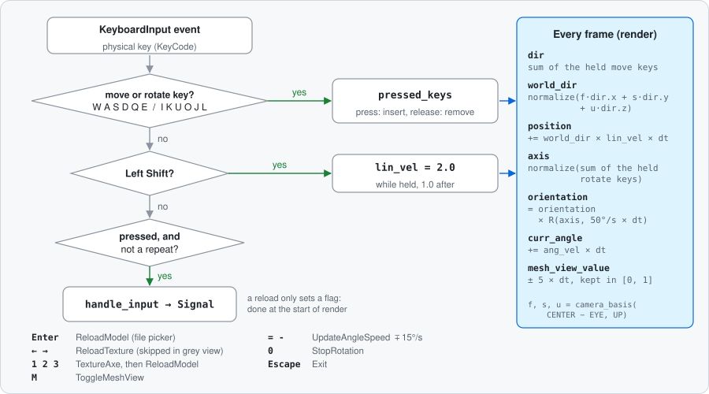
</p>

In the code:

- `pressed_keys` is a `HashSet<KeyCode>`; key events are read in `src/main.rs`, the movement in `App::render`.
- The rotation is multiplied **on the right** of `orientation`.
- Automatic rotation: `curr_angle` starts at −90°, `ang_vel` starts at 0.

<!-- TODO(Theo): Explique le système d'entrées.
     Questions pour t'aider :
     - Pourquoi un HashSet de touches enfoncées au lieu de réagir à chaque événement « pressed » ?
     - Pourquoi multiplier par dt ? Que se passerait-il sur un écran à 144 Hz sinon ?
     - Pourquoi normaliser world_dir ? Que se passe-t-il avec W et D enfoncées en même temps ?
     - Multiplier orientation à droite ou à gauche : quelle différence entre les axes de l'objet et ceux du monde ?
     Fichiers à relire : src/main.rs, src/key.rs, src/app/render.rs (render), src/math.rs (camera_basis)
-->

### The math behind Scop

Every formula below is copied from the code. Matrices are written in rows, even though they are stored in columns.

| Group | Formula | Code | Origin |
| --- | --- | --- | --- |
| [Vectors and camera](#vectors-and-camera) | length, normalisation, dot and cross product | `Vector3` (`src/math.rs`) | Rewritten (was `cgmath`) |
| | camera frame | `camera_basis` | Mine |
| | view matrix | `look_to_rh`, `look_at_rh` | Rewritten (was `cgmath`) |
| [Matrices](#matrices) | product of two matrices | `impl Mul for Matrix4` | Rewritten (was `cgmath`) |
| | translation | `from_translation` | Rewritten (was `cgmath`) |
| | rotation around an axis | `from_axis_angle` | Rewritten (was `cgmath`) |
| | perspective | `perspective`, `From<PerspectiveFov>` | Rewritten (was `cgmath`) |
| | Vulkan correction | `update_uniform_buffer` | Tutorial |
| [Geometry](#geometry) | Newell normal, projection to 2D | `project_face_2d` | Mine |
| | 2D cross product, convexity, point in triangle | `cross_2d`, `is_convex`, `is_in_triangle` | Mine |
| | bounding box, centre, scale | `compute_bounding_box`, `compute_centroid`, `load_model` | Mine |
| [Texture and shading](#texture-and-shading) | planar UV | `build_vertex` | Mine |
| | mip levels | `create_texture_image` | Tutorial |
| | grey shade, `mix` | `shader.frag` | Mine (`mix` is GLSL) |
| [Time and movement](#time-and-movement) | angle, position, orientation, transition | `src/main.rs`, `src/app/render.rs` | Mine |

<!-- TODO(Theo): Vérifie la colonne « Origin ». Pour chaque formule plus bas, explique en 2 ou 3 phrases :
     ce qu'elle calcule, pourquoi elle marche, et un petit exemple chiffré si possible.
     C'est ta meilleure révision pour la soutenance. -->
Box mapping (`load_model`), for a triangle `(a, b, c)`:

```math
n = (b - a) \times (c - a)
\qquad
k = \arg\max_i |n_i|
```

The two kept axes follow the same rule as the projection to 2D in [Geometry](#geometry): `((k+1) % 3, (k+2) % 3)` if `n_k ≥ 0`, otherwise swapped. The UV formula is then the planar one, with these two axes.

<!-- TODO(Theo): Pourquoi le plus grand |n_i| ? Que se passerait-il sans l'échange des axes quand n_k < 0 (indice : texture en miroir) ? -->

#### Vectors and camera

<p align="center">
  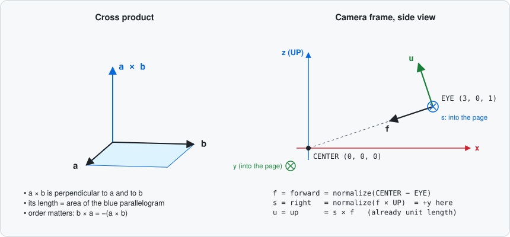
</p>

```math
\lVert v \rVert = \sqrt{x^2 + y^2 + z^2}
\qquad
\hat{v} = \frac{v}{\lVert v \rVert} \;(\text{and } \hat{v} = 0 \text{ if } \lVert v \rVert = 0)
```

```math
a \cdot b = a_x b_x + a_y b_y + a_z b_z
\qquad
a \times b = (a_y b_z - a_z b_y,\; a_z b_x - a_x b_z,\; a_x b_y - a_y b_x)
```

<!-- TODO(Theo): Que mesure le produit scalaire ? Que donne le produit vectoriel de deux vecteurs (direction, sens) ? -->

Camera frame (`camera_basis(dir, up)`):

```math
f = \widehat{dir} \qquad s = \widehat{f \times up} \qquad u = s \times f
```

<!-- TODO(Theo): Que représentent f, s et u ? Pourquoi u n'a-t-il pas besoin d'être normalisé ? -->

View matrix (`look_to_rh(eye, dir, up)`; `look_at_rh` calls it with `dir = center − eye`):

```math
V = \begin{pmatrix}
s_x & s_y & s_z & -\,eye \cdot s \\
u_x & u_y & u_z & -\,eye \cdot u \\
-f_x & -f_y & -f_z & eye \cdot f \\
0 & 0 & 0 & 1
\end{pmatrix}
```

<!-- TODO(Theo): Pourquoi les 3 premières lignes sont-elles les axes de la caméra ? À quoi sert la dernière colonne ? Pourquoi −f ? -->

#### Matrices

<p align="center">
  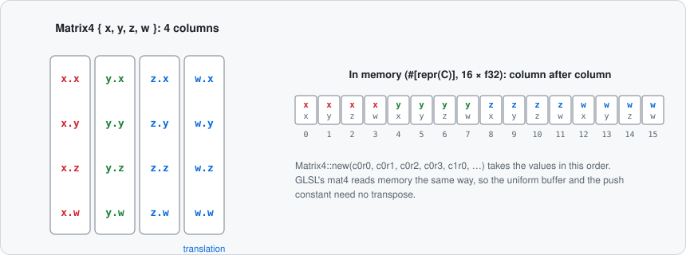
</p>

Product (`impl Mul for Matrix4`): column `j` of `A × B` is `A × (column j of B)`.

<!-- TODO(Theo): Pourquoi A × B ≠ B × A ? Qu'est-ce que ça change pour T × orientation × R_auto ? -->

<p align="center">
  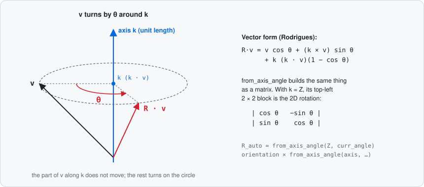
</p>

Translation (`from_translation(v)`) and rotation of angle θ around a unit axis `(x, y, z)` (`from_axis_angle`), with `c = cos θ`, `s = sin θ`, `t = 1 − c`:

```math
T = \begin{pmatrix}
1 & 0 & 0 & v_x \\
0 & 1 & 0 & v_y \\
0 & 0 & 1 & v_z \\
0 & 0 & 0 & 1
\end{pmatrix}
\qquad
R = \begin{pmatrix}
t x^2 + c & t x y - s z & t x z + s y & 0 \\
t x y + s z & t y^2 + c & t y z - s x & 0 \\
t x z - s y & t y z + s x & t z^2 + c & 0 \\
0 & 0 & 0 & 1
\end{pmatrix}
```

<!-- TODO(Theo): Pourquoi faut-il une matrice 4×4 pour une translation ? Vérifie R avec l'axe Z : retrouves-tu la rotation 2D classique ?
     (Cette formule s'appelle la formule de Rodrigues.) -->

<p align="center">
  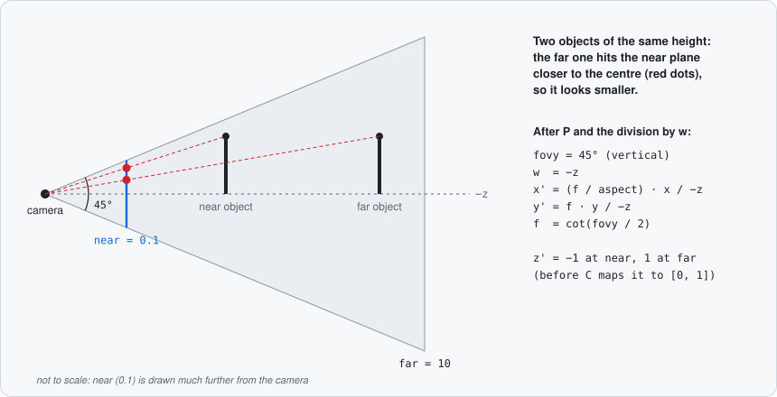
</p>

Perspective (`perspective(fovy, aspect, near, far)`), with `f = cot(fovy / 2)`:

```math
P = \begin{pmatrix}
\frac{f}{aspect} & 0 & 0 & 0 \\
0 & f & 0 & 0 \\
0 & 0 & \frac{far + near}{near - far} & \frac{2 \cdot far \cdot near}{near - far} \\
0 & 0 & -1 & 0
\end{pmatrix}
```

<!-- TODO(Theo): D'où vient cot(fovy / 2) ? Pourquoi −1 sur la dernière ligne (que devient w) ? Pourquoi diviser par aspect ? -->

<p align="center">
  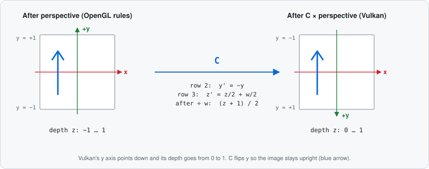
</p>

Vulkan correction (`update_uniform_buffer`), applied as `proj = correction × P`:

```math
C = \begin{pmatrix}
1 & 0 & 0 & 0 \\
0 & -1 & 0 & 0 \\
0 & 0 & \frac{1}{2} & \frac{1}{2} \\
0 & 0 & 0 & 1
\end{pmatrix}
```

<!-- TODO(Theo): À quoi sert chaque ligne (axe Y de Vulkan, profondeur entre 0 et 1 au lieu de −1 et 1) ? -->

#### Geometry

<p align="center">
  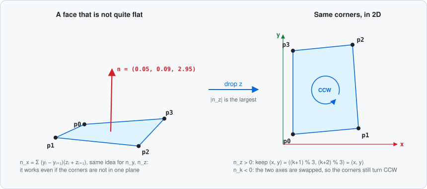
</p>

Newell normal of a face with vertices `p₀ … pₙ₋₁` (`project_face_2d`), with `pₙ = p₀`:

```math
n_x = \sum_i (y_i - y_{i+1})(z_i + z_{i+1}) \qquad
n_y = \sum_i (z_i - z_{i+1})(x_i + x_{i+1}) \qquad
n_z = \sum_i (x_i - x_{i+1})(y_i + y_{i+1})
```

Projection to 2D: `k` = axis where `|n_k|` is largest. The 2D point is `(p[(k+1) % 3], p[(k+2) % 3])` if `n_k ≥ 0`, otherwise `(p[(k+2) % 3], p[(k+1) % 3])`.

<!-- TODO(Theo): Pourquoi cette somme donne-t-elle une normale même pour une face non plane ? Pourquoi échanger les deux axes quand n_k < 0 ? -->

<p align="center">
  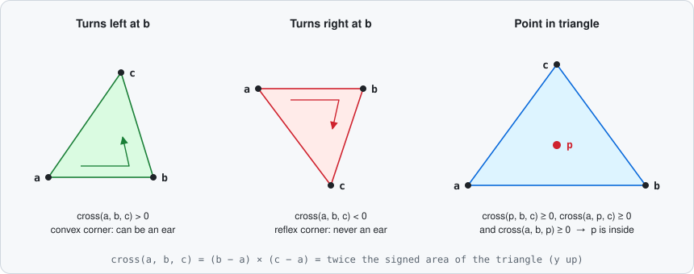
</p>

2D tests (`cross_2d`, `is_convex`, `is_in_triangle`):

```math
\text{cross}(a, b, c) = (b_x - a_x)(c_y - a_y) - (b_y - a_y)(c_x - a_x)
```

- `is_convex(a, b, c)`: `cross(a, b, c) > 0`
- `is_in_triangle(p, a, b, c)`: `cross(p, b, c) ≥ 0` and `cross(a, p, c) ≥ 0` and `cross(a, b, p) ≥ 0`

<!-- TODO(Theo): Que veut dire le signe de cross(a, b, c) ? Pourquoi ≥ 0 (et pas > 0) dans is_in_triangle ? -->

Centre and scale (`compute_bounding_box`, `compute_centroid`, `load_model`):

```math
centre = \frac{min + max}{2}
\qquad
factor = \frac{TARGET\_SIZE}{\max(max - min)}
\qquad
pos = \big((z - c_z),\, (x - c_x),\, (y - c_y)\big) \times factor
```

<!-- TODO(Theo): Pourquoi le centre de la boîte et pas la moyenne des sommets ? Que se passe-t-il si le modèle est plat (max − min = 0) ? -->

#### Texture and shading

<p align="center">
  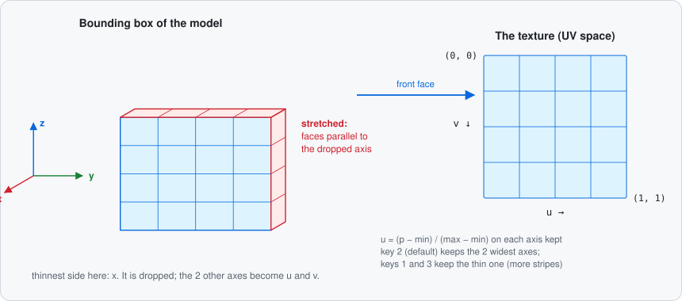
</p>

Planar UV (`build_vertex`), with `(y, x)` the two projection axes and `inv_extent = 1 / (max − min)` (or `0` if `max − min ≤ ε`):

```math
u = (p_x - min_x) \cdot inv\_extent_x \cdot ZOOM
\qquad
v = (1 - p_y - min_y) \cdot inv\_extent_y \cdot ZOOM
```

<!-- TODO(Theo): Que valent u et v aux coins de la boîte ? (Voir aussi l'item « Possible bugs » sur la formule de v.) -->

Mip levels (`create_texture_image`):

```math
mip\_levels = \lfloor \log_2(\max(width, height)) \rfloor + 1
```

Grey shade and transition (`shader.frag`; `mix` is defined by GLSL):

```math
shade = \text{clamp}\left(\frac{\text{mod}(id, 8)}{7},\; 0.1,\; 0.95\right)
\qquad
\text{mix}(a, b, t) = a \cdot (1 - t) + b \cdot t
```

<!-- TODO(Theo): Combien de niveaux pour une texture 1024×1024 ? Quelles sont les 8 valeurs de shade ? -->

#### Time and movement

`dt` = time since the previous frame.

```math
curr\_angle \mathrel{+}= ang\_vel \cdot dt
\qquad
mesh\_view\_value \mathrel{\pm}= MESH\_VIEW\_SPEED \cdot dt \;\;(\text{clamped to } [0, 1])
```

```math
world\_dir = \widehat{f \cdot dir_x + s \cdot dir_y + u \cdot dir_z}
\qquad
position \mathrel{+}= world\_dir \cdot lin\_vel \cdot dt
```

```math
orientation = orientation \times R(\widehat{axis},\; 50^\circ/s \cdot dt)
```

<!-- TODO(Theo): Pourquoi tout multiplier par dt ? Que se passe-t-il si dir = 0 (aucune touche) ? -->

### Technical choices

<!-- TODO(Theo): Pour chaque choix : 2 à 4 phrases. D'abord le problème, puis ce que tu as choisi, puis l'alternative et pourquoi tu ne l'as pas prise. -->

#### One `render_finished` semaphore per swapchain image

**In the code:** `render_finished_semaphores`, `images_in_flight`, the per-image command pools and their command buffers are created in `create_swapchain_sync_objects` / `create_image_command_pools` and destroyed in `destroy_swapchain` (commit `d2e57d1`).

<!-- Questions pour t'aider :
     - Que se passait-il avec un sémaphore par frame en vol (validation, image présentée trop tôt) ?
     - Pourquoi le nombre d'images peut-il changer quand la swapchain est recréée ?
     - Alternative : quelle autre façon de faire as-tu vue (tuto, spec, extension swapchain_maintenance1) ?
     Fichiers à relire : src/vulkan/sync.rs, src/vulkan/command.rs, src/app.rs
-->

#### Secondary command buffers

**In the code:** one primary command buffer per image opens the render pass with `SECONDARY_COMMAND_BUFFERS`, then executes one secondary command buffer per model (`self.models = 1`). From the tutorial chapter "Secondary command buffers".

<!-- Questions pour t'aider :
     - Avec un seul modèle, qu'apportent les buffers secondaires ? Les garderais-tu sur un nouveau projet ?
     - Alternative : tout enregistrer dans le buffer primaire, ou enregistrer une seule fois au lieu de chaque frame ?
     Fichiers à relire : src/app/render.rs (update_command_buffer, update_secondary_command_buffer)
-->

#### `gl_PrimitiveID` for the grey faces

**In the code:** the fragment shader reads `gl_PrimitiveID`; `create_logical_device` enables `geometry_shader(true)`.

<!-- Questions pour t'aider :
     - Pourquoi gl_PrimitiveID dans un fragment shader demande-t-il cette feature ?
     - Alternative : mettre une couleur par sommet (le champ color de Vertex) ? Quel problème avec les sommets partagés ?
     Fichiers à relire : shaders/shader.frag, src/vulkan/device.rs, src/model.rs
-->

#### A `float` instead of a `bool` in the push constants

**In the code:** `mesh_view` is pushed as an `f32` (`mesh_view_value`, between 0 and 1), while `App::mesh_view` stays a `bool` on the CPU side.

<!-- Questions pour t'aider :
     - Avec un bool, à quoi ressemblerait le changement de vue ?
     - Pourquoi garder un bool côté CPU ET un float côté GPU ?
     Fichiers à relire : src/app/render.rs, shaders/shader.frag
-->

#### Box mapping and the deduplication key

**In the code:** each triangle without `vt` gets its own projection axes from its normal (`get_normal_axis_max`); the key of `unique_vertices` is `(FaceVertex, axes)`, with `(0, 0)` as axes for corners that have a `vt` index. The planar projection is still available with `N`. Alternative not kept: triplanar mapping in the fragment shader.

<!-- Questions pour t'aider :
     - Quel défaut de la projection plane le box mapping corrige-t-il ? Montre-le avec les captures 42_planar.png et 42_boxmapping.png.
     - Triplanar mapping : qu'est-ce que c'est, et pourquoi ne pas l'avoir choisi (normales, coût, sujet) ?
     - Pourquoi l'axe doit-il être dans la clé ? Que verrait-on sur les arêtes du logo sans lui ?
     - Pourquoi (0, 0) pour les sommets qui ont un vt ? Pourquoi cette valeur ne peut-elle pas être confondue avec de vrais axes ?
     - Pourquoi avoir gardé la projection plane avec une touche ?
     Fichiers à relire : src/model.rs (load_model), src/obj.rs (get_normal_axis_max, FaceVertex)
-->

#### Movement relative to the camera

**In the code:** the held keys build a direction in the camera's frame `(forward, right, up)` with `camera_basis`, then converted to world space before moving the model.

<!-- Questions pour t'aider :
     - Avec un déplacement sur les axes du monde, que verrait l'utilisateur en appuyant sur W ?
     - Pourquoi réutiliser camera_basis, déjà écrit pour look_to_rh ?
     Fichiers à relire : src/math.rs (camera_basis, look_to_rh), src/app/render.rs
-->

#### Orientation stored as a matrix

**In the code:** `orientation: Matrix4` starts at the identity and is multiplied on the right by a small rotation each frame.

<!-- Questions pour t'aider :
     - Pourquoi pas trois angles (x, y, z) ? Qu'est-ce que le gimbal lock ?
     - Pourquoi une erreur d'arrondi s'accumule-t-elle dans une matrice multipliée à chaque frame ?
     - Alternative : quaternions ? Ré-orthonormaliser la matrice ?
     Fichiers à relire : src/app/render.rs, src/math.rs (from_axis_angle)
-->

#### Ear clipping instead of a fan

**In the code:** see [section 3](#3-triangulation-fan-then-ear-clipping) (commit `cb4ef8b`).

<!-- Questions pour t'aider :
     - Quelles faces cassent l'éventail ? Combien en as-tu dans tes modèles de test (trumpet.obj a des faces à 36 sommets) ?
     - Coût : l'ear clipping est en O(n²) ou O(n³) ? Est-ce un problème ici ?
     - Alternatives : triangulation de Delaunay, monotone polygons ?
     Fichiers à relire : src/obj.rs
-->

#### Precompiled `.spv` committed, `glslc` optional

**In the code:** `shaders/compile.sh` uses `glslc` from `PATH` or `~/.local/bin`; otherwise it keeps the committed `vert.spv` / `frag.spv`, and fails only if they are missing (commit `d9b0936`).

<!-- Questions pour t'aider :
     - Que se passe-t-il sur un poste de 42 sans glslc ?
     - Risque : un .spv commité qui ne correspond plus au .glsl. Comment l'éviter ?
     - Alternative : compiler les shaders depuis Rust (build.rs, crate shaderc) ? Est-ce autorisé par le sujet ?
     Fichiers à relire : shaders/compile.sh, Makefile (compile-shaders), src/vulkan/pipeline.rs
-->

#### Culling disabled

**In the code:** `cull_mode(vk::CullModeFlags::NONE)` (was `BACK`, commit `557678c`).

<!-- Questions pour t'aider :
     - Qu'est-ce que le back-face culling ? Pourquoi certains modèles devenaient-ils troués ou invisibles de l'intérieur ?
     - Coût : combien de triangles en plus sont dessinés ?
     - Alternative : garder BACK et corriger l'ordre des sommets (winding) des faces ?
     Fichiers à relire : src/vulkan/pipeline.rs
-->

### Bugs & lessons learned

Click on a bug to see what changed in the code.

<!-- TODO(Theo): Pour chaque bug, remplis « Why it broke » et « What I learned » (une ou deux phrases chacun),
     et complète les « (to describe / to confirm by Theo) ».
     Questions pour t'aider :
     - Pour chaque bug : comment l'as-tu remarqué (à l'écran, Valgrind, VmRSS, validation, println!) ?
     - Quel outil ou réflexe t'aurait fait gagner du temps ?
     - Les bugs 1, 2, 8 et 9 n'apparaissent pas dans l'historique Git : sont-ils bien arrivés, et dans quel fichier ?
     - Le bug 6 : quel message de validation as-tu eu ?
     Fichiers à relire : git log, src/math.rs, src/app.rs, src/app/render.rs, src/vulkan/render_pass.rs, src/vulkan/instance.rs
-->

#### Math

<details>
<summary><b>1.</b> The model orbits around a point instead of rotating on itself</summary>

- **What changed in the code:** `Matrix4 × Vector4` now reads the matrix by columns (`self.x.x * rhs.x + self.y.x * rhs.y + …`).
- **Commit:** (to confirm by Theo)
- **Why it broke:** <!-- TODO(Theo) -->
- **What I learned:** <!-- TODO(Theo) -->

</details>

<details>
<summary><b>2.</b> Wrong rotation</summary>

- **What changed in the code:** one term of `from_axis_angle` fixed.
- **Commit:** (to confirm by Theo)
- **Why it broke:** <!-- TODO(Theo) -->
- **What I learned:** <!-- TODO(Theo) -->

</details>

#### Memory

<details>
<summary><b>3.</b> Memory grows every frame</summary>

- **What changed in the code:** `resize_with(image_index + 1)` removed from `update_secondary_command_buffer`; the list is sized in `create_command_buffers`. The line was in the tutorial's text, not in its source code.
- **Commit:** `04c4605`
- **Why it broke:** <!-- TODO(Theo) -->
- **What I learned:** <!-- TODO(Theo) -->

</details>

<details>
<summary><b>4.</b> Memory grows at each window resize</summary>

- **What changed in the code:** per-image command pools destroyed in `destroy_swapchain` and recreated with the swapchain. The tutorial's repository has the same leak.
- **Commit:** `d2e57d1`
- **Why it broke:** <!-- TODO(Theo) -->
- **What I learned:** <!-- TODO(Theo) -->

</details>

#### Vulkan

<details>
<summary><b>5.</b> No validation message while the program runs</summary>

- **What changed in the code:** `create_debug_utils_messenger_ext` called after the instance is created (before, the callback was only chained to `create_instance`).
- **Commit:** `04c4605`
- **Why it broke:** <!-- TODO(Theo) -->
- **What I learned:** <!-- TODO(Theo) -->

</details>

<details>
<summary><b>6.</b> <i>(symptom to describe by Theo)</i>: depth access flag in the render pass dependency</summary>

- **What changed in the code:** `DEPTH_STENCIL_ATTACHMENT_READ` replaced by `DEPTH_STENCIL_ATTACHMENT_WRITE` in the render pass dependency.
- **Commit:** `04c4605`
- **Why it broke:** <!-- TODO(Theo) -->
- **What I learned:** <!-- TODO(Theo) -->

</details>

<details>
<summary><b>7.</b> Error when the window is resized</summary>

- **What changed in the code:** `OUT_OF_DATE_KHR` from `acquire_next_image_khr` is matched: the swapchain is recreated and the frame skipped (before, `?` returned the error).
- **Commit:** `04c4605`
- **Why it broke:** <!-- TODO(Theo) -->
- **What I learned:** <!-- TODO(Theo) -->

</details>

<details>
<summary><b>8.</b> <i>(symptom to describe by Theo)</i>: texture reload destroyed the wrong pool</summary>

- **What changed in the code:** the texture reload destroys the descriptor pool instead of the command pool.
- **Commit:** (to confirm by Theo)
- **Why it broke:** <!-- TODO(Theo) -->
- **What I learned:** <!-- TODO(Theo) -->

</details>

<details>
<summary><b>9.</b> <i>(symptom to describe by Theo)</i>: <code>render_finished</code> semaphore index</summary>

- **What changed in the code:** `render_finished` semaphores indexed by `image_index` instead of `frame` (comment removed in `798a975`).
- **Commit:** (to confirm by Theo: fixed before the first commit)
- **Why it broke:** <!-- TODO(Theo) -->
- **What I learned:** <!-- TODO(Theo) -->

</details>

#### Geometry, animation and files

<details>
<summary><b>10.</b> The model jumps when the rotation speed changes</summary>

- **What changed in the code:** the angle is accumulated, `curr_angle += ang_vel × dt`, instead of `ang_vel × total time`.
- **Commit:** `e3085d6`
- **Why it broke:** <!-- TODO(Theo) -->
- **What I learned:** <!-- TODO(Theo) -->

</details>

<details>
<summary><b>11.</b> Triangles outside concave faces</summary>

- **What changed in the code:** fan triangulation replaced by ear clipping; test file `concave_test.obj` added.
- **Commits:** `cb4ef8b`, `b36c222`
- **Why it broke:** <!-- TODO(Theo) -->
- **What I learned:** <!-- TODO(Theo) -->

</details>

<details>
<summary><b>12.</b> Model shown upside down</summary>

- **What changed in the code:** axes reordered `(x, y, z)` → `(z, x, y)` in `build_vertex`.
- **Commit:** `8fbe375`
- **Why it broke:** <!-- TODO(Theo) -->
- **What I learned:** <!-- TODO(Theo) -->

</details>

<details>
<summary><b>13.</b> Panic on a texture that is not 1024×1024</summary>

- **What changed in the code:** the size check returns an error with the expected size instead of `panic!` (the check came from the tutorial).
- **Commit:** `9fe9953`
- **Why it broke:** <!-- TODO(Theo) -->
- **What I learned:** <!-- TODO(Theo) -->

</details>

### Project structure

```text
.
├── Cargo.toml                 crates and their versions
├── Cargo.lock                 exact versions of every dependency
├── Makefile                   build rules (see Instructions)
├── README.md                  this file
├── docs/diagrams/             README figures (SVG, adapt to light and dark themes) and make_diagrams.py
├── docs/images/               banner, screenshots (list in docs/images/README.md), make_banner.py
├── resources/
│   ├── model/
│   │   ├── 42.obj             default model (DEFAULT_MODEL), triangles and quads
│   │   ├── 42_bugged.obj      42.obj with a malformed `v` line (line 6), to test errors
│   │   ├── concave_test.obj   a concave "L" face (6 vertices) and a star face (10 vertices)
│   │   ├── shuttle.obj        space shuttle, triangles and quads
│   │   ├── teapot.obj         Utah teapot, triangles
│   │   ├── teapot2.obj        Utah teapot, Blender export (other coordinates)
│   │   ├── trumpet.obj        trumpet, faces up to 36 vertices
│   │   └── viking_room.obj    the only model with `vt` coordinates (v/vt/vn)
│   └── texture/
│       ├── bark.ppm           1024×1024 P6
│       ├── chaton.ppm         1024×1024 P6
│       └── viking_room.ppm    1024×1024 P6, made for viking_room.obj
├── shaders/
│   ├── compile.sh             compiles the GLSL with glslc, or keeps the .spv
│   ├── shader.vert            vertex shader (GLSL 450)
│   ├── shader.frag            fragment shader (GLSL 450)
│   ├── vert.spv               compiled vertex shader (committed)
│   └── frag.spv               compiled fragment shader (committed)
└── src/
    ├── main.rs                window, event loop, keyboard dispatch
    ├── key.rs                 key mapping, Signal enum, file picker, texture index
    ├── app.rs                 App: create, recreate_swapchain, destroy
    ├── app/
    │   ├── data.rs            AppData: every Vulkan handle + model and texture state
    │   └── render.rs          one frame, reload model/texture, command buffers, uniform buffer
    ├── math.rs                vectors, Matrix4, Deg/Rad, perspective, look-at, camera_basis
    ├── model.rs               Vertex, load_model (centre, scale, UVs: planar or box mapping, deduplication)
    ├── obj.rs                 OBJ parser, ear clipping, bounding box
    ├── ppm.rs                 PPM (P6) parser
    ├── vulkan.rs              list of the vulkan/ modules
    └── vulkan/
        ├── instance.rs        instance, validation layer, debug callback
        ├── device.rs          GPU choice, queue families, MSAA, logical device
        ├── swapchain.rs       swapchain and its image views
        ├── render_pass.rs     render pass (colour MSAA, depth, resolve)
        ├── pipeline.rs        graphics pipeline, push constant ranges, shader modules
        ├── framebuffer.rs     one framebuffer per swapchain image
        ├── attachment.rs      MSAA colour image, depth image, depth format
        ├── command.rs         command pools, command buffers, one-time commands
        ├── sync.rs            semaphores and fences
        ├── descriptor.rs      descriptor set layout, pool and sets
        ├── buffer.rs          buffers: vertex, index, uniform, staging
        ├── image.rs           images, image views, layout transitions, buffer → image copy
        ├── memory.rs          memory type selection
        └── texture.rs         texture loading, sampler, mipmaps
```

<details>
<summary><b>Module dependencies</b> (who uses whom)</summary>

<p align="center">
  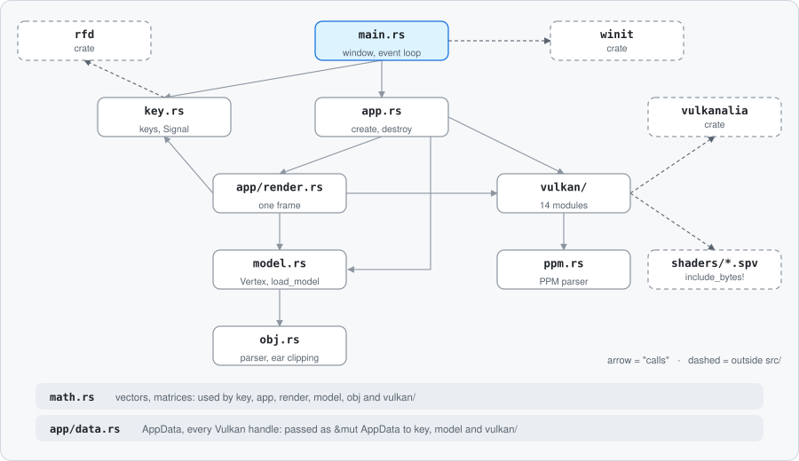
</p>

</details>

### Known limitations / future work

<!-- TODO(Theo): Liste les limites connues et ce que tu ferais ensuite. Une puce par limite : le problème, puis la piste.
     Pistes :
     - box mapping : coutures visibles entre deux zones projetées sur des axes différents → triplanar mapping ;
     - dérive de la matrice d'orientation (erreurs d'arrondi accumulées) → quaternions ou ré-orthonormalisation ;
     - zones grises vis-à-vis du sujet : crates rfd (sélecteur de fichiers), anyhow / thiserror, et tobj, présent dans Cargo.toml mais pas utilisé dans src/ ;
     - pas d'argument en ligne de commande pour choisir le .obj ;
     - parser PPM : P6 seulement, maxval 255, un élément d'en-tête par ligne ;
     - pas de mode fil de fer (PolygonMode::FILL seulement), pas d'éclairage (les normales vn sont lues mais pas utilisées) ;
     - geometryShader demandé à la création du device mais pas vérifié au choix du GPU ;
     - aucun test (make test ne lance rien), aucun modèle de test avec des indices négatifs.
     Questions pour t'aider :
     - Qu'est-ce qui te gêne le plus aujourd'hui dans ton code ?
     - Si tu refaisais le projet, que ferais-tu dans un autre ordre ?
     Fichiers à relire : Cargo.toml, src/model.rs, src/ppm.rs, src/vulkan/device.rs, src/vulkan/pipeline.rs
-->

---

## Resources

### References

**Vulkan**

- [Vulkan Tutorial (Rust), Kyle Mayes, with `vulkanalia`](https://kylemayes.github.io/vulkanalia/): base of the Vulkan code (chapters 1 to 37), in particular [Swapchain recreation](https://kylemayes.github.io/vulkanalia/swapchain/recreation.html), [Push constants](https://kylemayes.github.io/vulkanalia/dynamic/push_constants.html), [Recycling command buffers](https://kylemayes.github.io/vulkanalia/dynamic/recycling_command_buffers.html) and [Secondary command buffers](https://kylemayes.github.io/vulkanalia/dynamic/secondary_command_buffers.html)
- [`vulkanalia` repository](https://github.com/KyleMayes/vulkanalia) and [the tutorial's source code](https://github.com/KyleMayes/vulkanalia/tree/master/tutorial/src)
- [`vulkanalia` 0.35.0 API documentation](https://docs.rs/vulkanalia/0.35.0/vulkanalia/)
- [Vulkan Tutorial (original C++ version), Alexander Overvoorde](https://vulkan-tutorial.com/)
- [Vulkan specification](https://docs.vulkan.org/spec/latest/index.html)
- [The new Vulkan coordinate system, Matthew Wellings](https://matthewwellings.com/blog/the-new-vulkan-coordinate-system/) (the correction matrix)

**Math**

- [`cgmath` documentation](https://docs.rs/cgmath/latest/cgmath/): the math crate used by the tutorial, replaced by `src/math.rs`
- [OpenGL Projection Matrix, Song Ho Ahn](https://www.songho.ca/opengl/gl_projectionmatrix.html)
- [LearnOpenGL: Coordinate Systems](https://learnopengl.com/Getting-started/Coordinate-Systems) and [Camera](https://learnopengl.com/Getting-started/Camera)
- [Rodrigues' rotation formula (Wikipedia)](https://en.wikipedia.org/wiki/Rodrigues%27_rotation_formula)
- [Cross product (Wikipedia)](https://en.wikipedia.org/wiki/Cross_product)

**Shaders and GLSL**

- Khronos GLSL reference pages: [`mix`](https://registry.khronos.org/OpenGL-Refpages/gl4/html/mix.xhtml), [`mod`](https://registry.khronos.org/OpenGL-Refpages/gl4/html/mod.xhtml), [`clamp`](https://registry.khronos.org/OpenGL-Refpages/gl4/html/clamp.xhtml), [`gl_PrimitiveID`](https://registry.khronos.org/OpenGL-Refpages/gl4/html/gl_PrimitiveID.xhtml)
- [GLSL 4.60 specification](https://registry.khronos.org/OpenGL/specs/gl/GLSLangSpec.4.60.html)
- [The Book of Shaders](https://thebookofshaders.com/)
- [LearnOpenGL: Shaders](https://learnopengl.com/Getting-started/Shaders)

**Window and events**

- [`winit` 0.29.15 documentation](https://docs.rs/winit/0.29.15/winit/) and [repository](https://github.com/rust-windowing/winit)
- [`rfd` 0.17.2 documentation](https://docs.rs/rfd/0.17.2/rfd/)

**File formats**

- [Wavefront .obj file (Wikipedia)](https://en.wikipedia.org/wiki/Wavefront_.obj_file)
- [OBJ files, John Burkardt's collection](https://people.sc.fsu.edu/~jburkardt/data/obj/obj.html)
- [PPM format specification (Netpbm)](https://netpbm.sourceforge.net/doc/ppm.html)

**Geometry and texturing**

- [Triangulation by Ear Clipping, David Eberly (PDF)](https://www.geometrictools.com/Documentation/TriangulationByEarClipping.pdf)
- [Calculating a Surface Normal, Khronos OpenGL wiki](https://www.khronos.org/opengl/wiki/Calculating_a_Surface_Normal) (Newell's method)
- [Triplanar Mapping, Catlike Coding](https://catlikecoding.com/unity/tutorials/advanced-rendering/triplanar-mapping/)
- [Blender manual, Image Texture node ("Box" projection)](https://docs.blender.org/manual/en/latest/render/shader_nodes/textures/image.html)

<!-- TODO(Theo): Les liens Khronos wiki (Calculating a Surface Normal) et songho.ca n'ont pas pu être vérifiés automatiquement
     (le site bloque les requêtes non-navigateur). Les liens ajoutés dans « Math » (cgmath, LearnOpenGL Camera, Wikipedia) non plus.
     Ouvre-les dans un navigateur. Ajoute les ressources que tu as vraiment utilisées et retire celles que tu n'as pas lues. -->

### AI usage

AI (Claude, by Anthropic) was used during this project. The list below is **to be checked and completed by Theo**.

- **Main role: teaching assistant.** The AI guided with questions instead of giving the code, in particular for `math.rs`, the OBJ and PPM parsers, keyboard handling, the file browsing, texture switching, movement and rotation, the steps of ear clipping (Newell normal, 2D projection, geometric tests) and the steps of box mapping (normal of each triangle, choice of the axes, deduplication key).
- **Explaining concepts:** Vulkan objects and synchronisation, the column-major convention, the cross product, the camera frame, UV coordinates and box mapping, modulo to loop over a list, GLSL.
- **Debugging help:** finding memory leaks (Valgrind tests, `VmRSS`, `println!`), reading validation errors, comparing the code with the tutorial's official repository.
- **Code written by the AI at Theo's request:**
  - refactor of the per-image resources (command pools and sync objects recreated with the swapchain);
  - the `make deps` rule and fixes to the `Makefile`;
  - `shaders/compile.sh`;
  - the test file `resources/model/concave_test.obj`.
- **Code review:** idiomatic Rust, naming, consistency with the subject.
- **This README:** structure, diagrams, tables, the facts and formulas copied from the code, the banner and the figures (`docs/images/make_banner.py`, `docs/diagrams/make_diagrams.py`). The figures contain short explanations; every explanation in the text is written by Theo.

<!-- TODO(Theo): Ton propre bilan de l'usage de l'IA.
     Questions pour t'aider :
     - La liste ci-dessus est-elle exacte et complète ? Qu'est-ce qui manque (split en modules de src/vulkan/) ?
     - Qu'as-tu appris grâce aux questions plutôt qu'aux réponses ? Un exemple précis ?
     - Quand l'IA s'est-elle trompée ou t'a-t-elle fait perdre du temps ? Comment l'as-tu vérifié ?
     - Saurais-tu réécrire et expliquer en soutenance chaque partie écrite par l'IA ?
     Fichiers à relire : git log, src/vulkan/command.rs, src/vulkan/sync.rs, Makefile, shaders/compile.sh, src/model.rs, src/obj.rs
-->
